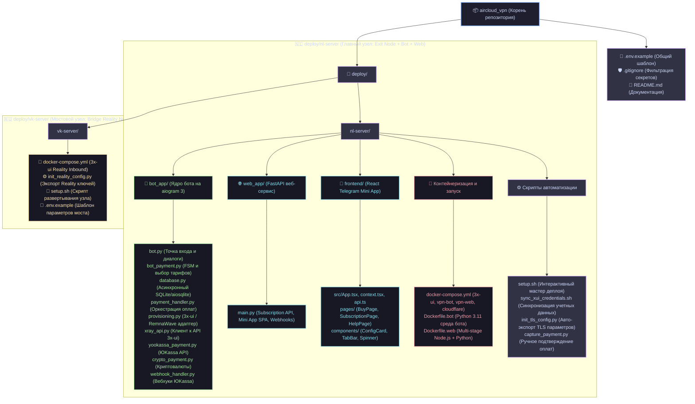
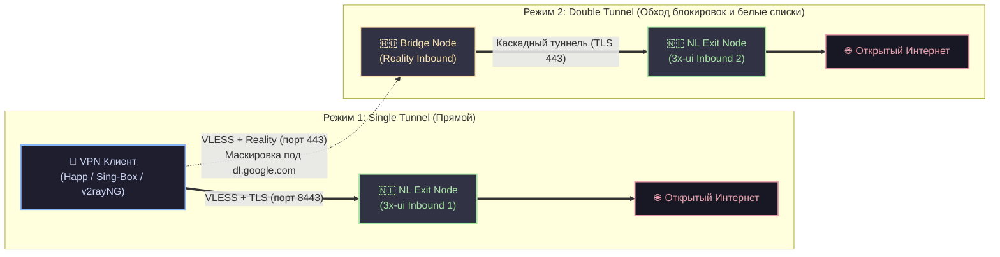
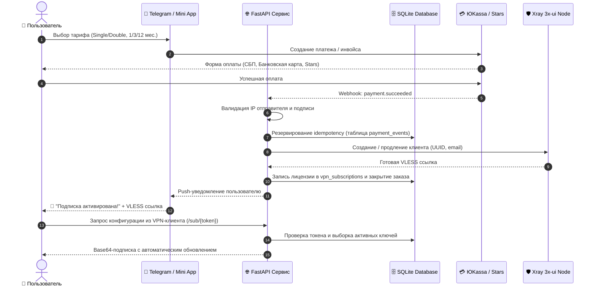

# 🌐 AirCloud VPN

[](https://www.python.org/)
[](https://docs.aiogram.dev/)
[](https://fastapi.tiangolo.com/)
[](https://react.dev/)
[](https://www.docker.com/)
[](https://github.com/XTLS/Xray-core)

**AirCloud VPN** — открытый программный комплекс для организации и продажи VPN-сервиса на базе протоколов **Xray-core (VLESS / Reality)**. 

Проект спроектирован для надежной работы в условиях активных сетевых блокировок (DPI) и включает Telegram-бота на **aiogram 3**, веб-интерфейс **Telegram Mini App** на **React / TypeScript**, **FastAPI** сервис для раздачи подписок и биллинга, а также модульные адаптеры провижининга (**3x-ui** и **RemnaWave**).

---

## 📑 Содержание

- [✨ Ключевые возможности](#-ключевые-возможности)
- [📁 Визуальная структура проекта (Mermaid)](#-визуальная-структура-проекта-mermaid)
- [🏛️ Архитектура и сетевые потоки](#️-архитектура-и-сетевые-потоки)
  - [Топология туннелей (Single vs Double Tunnel)](#топология-туннелей-single-vs-double-tunnel)
  - [Сценарий оплаты и активации (Sequence Diagram)](#сценарий-оплаты-и-активации-sequence-diagram)
- [🚀 Быстрый старт](#-быстрый-старт)
  - [1. Подготовка сервера](#1-подготовка-сервера)
  - [2. Настройка окружения](#2-настройка-окружения)
  - [3. Запуск основного узла (Exit Node)](#3-запуск-основного-узла-exit-node)
  - [4. Запуск мостового узла (Bridge Reality Node)](#4-запуск-мостового-узла-bridge-reality-node)
- [💳 Настройка платежных систем](#-настройка-платежных-систем)
- [⚙️ Справочник переменных (.env)](#️-справочник-переменных-env)
- [📱 Поддерживаемые VPN клиенты](#-поддерживаемые-vpn-клиенты)
- [🔒 Аудит и чеклист безопасности](#-аудит-и-чеклист-безопасности)
- [📄 Лицензия](#-лицензия)

---

## ✨ Ключевые возможности

- 🤖 **Telegram Бот (aiogram 3)**:
  - Автоматическая регистрация пользователей, выдача персональных VLESS-ключей.
  - Покупка, продление, подарочные активации (`/gift`) и мониторинг подписки.
  - Уведомления об истечении срока действия.
  - Защищенная панель администратора (`/admin`): статистика клиентов и управление базой.
- 📱 **Telegram Mini App (React + TypeScript + Vite)**:
  - Современный личный кабинет прямо внутри мессенджера.
  - Выбор тарифов, локаций и способов оплаты.
  - Копирование ключа и ссылки на подписку в один клик.
- 🔗 **Универсальный Subscription API (FastAPI)**:
  - Динамическая выдача конфигураций по защищенному токену пользователя (`/sub/{token}`).
  - Полная совместимость со всеми популярными клиентами (Happ, v2rayNG, Sing-Box, Streisand, Hiddify, FoXray).
- 🛡️ **Двухуровневая топология туннелей**:
  - **Single Tunnel**: Прямое скоростное подключение к основному серверу выхода (VLESS + TLS).
  - **Double Tunnel**: Двойной каскадный туннель через мостовой сервер с обфускацией **VLESS-Reality** (маскировка под трафик популярных HTTPS-ресурсов, обход DPI и блокировок) и выходом в интернет через целевой сервер.
- 💳 **Мульти-платежи с защитой от сбоев**:
  - **ЮKassa**: Банковские карты (МИР, Visa, Mastercard), СБП. Валидация подлинности вебхуков по официальным подсетям ЮKassa и идемпотентная активация.
  - **Telegram Stars**: Нативная встроенная валюта Telegram с мгновенной активацией.
  - **Криптовалюта**: Модуль криптоплатежей (USDT, TON, BSC).
- 🔄 **Модульный провижининг**:
  - Прямое управление узлами через API панелей **3x-ui** (`ghcr.io/mhsanaei/3x-ui`).
  - Готовый адаптер для интеграции с панелью **RemnaWave**.

---

## 📁 Визуальная структура проекта (Mermaid)

Структура репозитория разделена на независимые узлы развертывания и сервисные модули:



---

## 🏛️ Архитектура и сетевые потоки

### Топология туннелей (Single vs Double Tunnel)



### Сценарий оплаты и активации (Sequence Diagram)



---

## 🚀 Быстрый старт

### 1. Подготовка сервера

Вам понадобится виртуальный сервер (VPS/VDS) под управлением **Ubuntu 22.04 / 24.04 LTS** с установленными **Docker** и **Docker Compose**.

```bash
# Быстрая установка Docker
curl -fsSL https://get.docker.com -o get-docker.sh && sudo sh get-docker.sh
sudo usermod -aG docker $USER
```

### 2. Настройка окружения

Клонируйте репозиторий и перейдите в папку основного сервера:

```bash
git clone https://github.com/yourusername/aircloud_vpn.git
cd aircloud_vpn/deploy/nl-server

# Создайте файл .env из чистого шаблона
cp .env.example .env
nano .env
```

Отредактируйте параметры:
- `BOT_TOKEN`: токен вашего бота от [@BotFather](https://t.me/BotFather)
- `ADMIN_IDS`: ваш числовой Telegram ID (узнать в [@userinfobot](https://t.me/userinfobot))
- `NL_SERVER_IP`: публичный IP адрес сервера
- `XRAY_PASSWORD`: надежный пароль к панели управления

### 3. Запуск основного узла (Exit Node)

Запустите автоматический мастер настройки:
```bash
chmod +x setup.sh sync_xui_credentials.sh entrypoint.sh
./setup.sh
```

Или запустите сервисы напрямую через Docker Compose:
```bash
docker compose up -d --build
```

**Развернутые контейнеры:**
- `nl-xray-panel` — веб-панель 3x-ui на порту `54321` (внутри сети `2053`).
- `vpn-bot` — Telegram-бот с автоподключением к базе данных и панели.
- `vpn-web` — FastAPI сервер (порт `8000`) с встроенным фронтендом Mini App и Subscription API.
- `vpn-cloudflare-tunnel` — защищенный туннель Cloudflare для доступа к Mini App по HTTPS.

### 4. Запуск мостового узла (Bridge Reality Node)

Если требуется обход блокировок по схеме **Double Tunnel**:

1. На втором сервере (мост в РФ/транзитный VPS) скопируйте папку `deploy/vk-server`:
   ```bash
   cd deploy/vk-server
   cp .env.example .env
   nano .env
   ```
2. Запустите мостовой узел:
   ```bash
   chmod +x setup.sh
   ./setup.sh
   ```
3. В панели 3x-ui мостового узла создайте inbound с протоколом **VLESS + Reality** на 443 порту.
4. Скопируйте публичный ключ Reality (`REALITY_PUBLIC_KEY`) и Short ID (`REALITY_SHORT_ID`) в файл `.env` на основном сервере.

---

## 💳 Настройка платежных систем

### ЮKassa
1. Зарегистрируйтесь на [yookassa.ru](https://yookassa.ru/) и создайте магазин.
2. В файле `.env` укажите:
   ```env
   YOOKASSA_ENABLED=True
   YOOKASSA_SHOP_ID=ваш_shop_id
   YOOKASSA_SECRET_KEY=live_ваш_секретный_ключ
   ```
3. В личном кабинете ЮKassa настройте Webhook на URL:  
   `https://vpn.yourdomain.com/webhook/yookassa` (события `payment.succeeded` и `payment.canceled`).

### Telegram Stars
1. Откройте [@BotFather](https://t.me/BotFather) → `/mybots` → выберите бота → **Bot Settings** → **Payments**.
2. В файле `.env` активируйте:
   ```env
   TELEGRAM_STARS_ENABLED=True
   ```
3. Оплата проходит нативно в приложении Telegram без комиссии за эквайринг.

---

## ⚙️ Справочник переменных (.env)

| Переменная | Назначение | Пример / Значение |
|---|---|---|
| `BOT_TOKEN` | Токен бота Telegram | `1234567890:ABCdef...` |
| `ADMIN_IDS` | ID администраторов бота | `123456789` |
| `SUPPORT_LINK` | Ссылка на аккаунт/группу поддержки | `https://t.me/your_support` |
| `NL_SERVER_IP` | Публичный IP адрес сервера выхода | `198.51.100.1` |
| `VK_SERVER_IP` | Публичный IP адрес мостового сервера | `203.0.113.1` |
| `XRAY_HOST` | Имя хоста Xray в docker-сети | `xray-panel` |
| `XRAY_PORT` | Порт API панели 3x-ui | `2053` |
| `XRAY_USERNAME` | Логин администратора 3x-ui | `admin` |
| `XRAY_PASSWORD` | Пароль администратора 3x-ui | `change_me_to_strong_pass` |
| `SUBSCRIPTION_BASE_URL`| Публичный HTTPS URL сервиса подписок | `https://vpn.yourdomain.com` |
| `MINI_APP_URL` | URL для запуска Telegram Mini App | `https://vpn.yourdomain.com/app` |
| `PROVISIONER_MODE` | Режим провижининга | `legacy` (3x-ui) или `remnawave` |
| `STRICT_CONFIG` | Строгая проверка настроек при старте | `true` |

---

## 📱 Поддерживаемые VPN клиенты

Сгенерированные VLESS-ссылки и адрес подписки формата `/sub/{token}` полностью поддерживаются клиентами:

- **iOS / iPadOS / macOS**: Happ, Streisand, FoXray, Sing-Box, Shadowrocket, V2Box.
- **Android**: v2rayNG, Happ, Hiddify, NekoBox, Sing-Box.
- **Windows / Linux**: v2rayN, Hiddify, Nekoray, Sing-Box.

---

## 🔒 Аудит и чеклист безопасности

При подготовке проекта к открытой публикации выполнен комплексный аудит безопасности:

### 1. Защита учетных данных и изоляция секретов
- ✅ Все реальные токены, боевые ключи ЮKassa, приватные пароли баз данных и публичные IP удалены из репозитория.
- ✅ Настроен строгий [.gitignore](file:///c:/Users/Данила/Documents/GitHub/aircloud_vpn/.gitignore), блокирующий попадание `.env`, `.pem`, `.key`, `.db`, `.log` в коммиты.
- ✅ Пользователям Telegram в командах `/status` **не отображаются** внутренние адреса панелей управления (`http://IP:54321`) и системные порты.

### 2. Защита API и веб-сервисов
- ✅ **Telegram WebApp HMAC-SHA256**: В [web_app/main.py](file:///c:/Users/Данила/Documents/GitHub/aircloud_vpn/deploy/nl-server/web_app/main.py) проверяется криптографическая подпись `X-Telegram-Init-Data` с контролем времени жизни (`auth_date`) для предотвращения подделки запросов к Mini App.
- ✅ **Валидация источников вебхуков**: В [webhook_handler.py](file:///c:/Users/Данила/Documents/GitHub/aircloud_vpn/deploy/nl-server/bot_app/webhook_handler.py) запросы от ЮKassa проверяются по официальным доверенным CIDR-подсетям.
- ✅ **Идемпотентность транзакций**: Повторные вебхуки или сбои сети не приводят к двойной активации благодаря блокировкам в таблице `payment_events`.
- ✅ **Криптостойкие токены**: Токены подписок генерируются через модуль `secrets.token_urlsafe(16)` (высокая энтропия, защита от перебора).

### 3. Рекомендации для Production-сервера
- 🛡️ **Закрытие порта панели 3x-ui**: В `docker-compose.yml` рекомендуется изменить `"54321:2053"` на `"127.0.0.1:54321:2053"` и заходить в веб-интерфейс через SSH-туннель:
  ```bash
  ssh -L 54321:127.0.0.1:54321 user@YOUR_SERVER_IP
  ```
- 🛡️ **Настройка файрвола (UFW)**:
  ```bash
  sudo ufw default deny incoming
  sudo ufw default allow outgoing
  sudo ufw allow 22/tcp    # SSH
  sudo ufw allow 80/tcp    # HTTP (Let's Encrypt)
  sudo ufw allow 443/tcp   # HTTPS / Reality Inbound
  sudo ufw allow 8443/tcp  # Single Tunnel VLESS TLS
  sudo ufw enable
  ```
- 🛡️ **HTTPS для Subscription API**: Используйте Nginx, Caddy или Cloudflare Tunnel для шифрования трафика между клиентом и сервером подписок.

---

## 📄 Авторские права / Copyright

Copyright (c) 2026 AirCloud ([airwar31](https://github.com/airwar31)). Все права защищены / All rights reserved.
